# Database ERD

Generated from the Django models in `backend/apps/*/models.py`. Table and column names match the migrations. Order rows keep `shipping_address_snapshot` and `billing_address_snapshot` (JSON) plus the `snapshot_*` columns on `order_item`, so history survives edits to addresses and variants.

```mermaid
erDiagram
  address {
    bigint address_id PK
    bigint user_id FK
    varchar full_name
    varchar phone
    varchar line1
    varchar line2  "nullable"
    varchar district
    varchar province
    varchar postcode
    varchar country
    boolean is_default_shipping
    boolean is_default_billing
    timestamptz created_at
    timestamptz updated_at
  }
  admin {
    bigint admin_id PK
    varchar email UK
    varchar password_hash
    varchar display_name
    boolean is_active
    timestamptz created_at
    timestamptz updated_at
  }
  analytics_event {
    bigint event_id PK
    bigint user_id FK "nullable"
    varchar session_id  "nullable"
    varchar event_type
    bigint product_id FK "nullable"
    bigint product_variant_id FK "nullable"
    bigint cart_id FK "nullable"
    bigint order_id FK "nullable"
    varchar search_query  "nullable"
    integer event_count
    numeric event_value  "nullable"
    jsonb metadata_json  "nullable"
    timestamptz created_at
  }
  campaign_products {
    bigint campaign_product_id PK
    bigint campaign_id FK
    bigint product_id FK
    timestamptz created_at
  }
  campaigns {
    bigint campaign_id PK
    varchar name
    varchar type
    varchar message  "nullable"
    numeric discount_value  "nullable"
    varchar status
    date start_date
    date end_date
    bigint created_by_admin_id FK "nullable"
    timestamptz created_at
    timestamptz updated_at
  }
  cart {
    bigint cart_id PK
    bigint user_id FK
    varchar status
    timestamptz created_at
    timestamptz updated_at
  }
  cart_item {
    bigint cart_item_id PK
    bigint cart_id FK
    bigint product_variant_id FK
    integer quantity
    timestamptz created_at
    timestamptz updated_at
  }
  category {
    bigint category_id PK
    bigint parent_category_id FK "nullable"
    varchar category_name
    varchar slug UK
    boolean is_hidden
    timestamptz created_at
    timestamptz updated_at
  }
  category_translation {
    bigint category_translation_id PK
    bigint category_id FK
    varchar language_code
    varchar name
    timestamptz created_at
    timestamptz updated_at
  }
  email_verification_tokens {
    bigint email_verification_token_id PK
    bigint user_id FK
    varchar token UK
    timestamptz expires_at
    timestamptz used_at  "nullable"
    timestamptz created_at
  }
  order_item {
    bigint order_item_id PK
    bigint order_id FK
    bigint product_variant_id FK "nullable"
    varchar snapshot_product_name
    varchar snapshot_color  "nullable"
    varchar snapshot_size  "nullable"
    numeric snapshot_unit_price
    numeric snapshot_compare_at_price  "nullable"
    integer quantity
    numeric line_total
  }
  orders {
    bigint order_id PK
    bigint user_id FK
    bigint shipping_address_id FK "nullable"
    bigint billing_address_id FK "nullable"
    varchar status
    numeric subtotal
    numeric shipping_fee
    numeric vat_amount
    numeric total
    jsonb shipping_address_snapshot  "nullable"
    jsonb billing_address_snapshot  "nullable"
    timestamptz created_at
    timestamptz updated_at
  }
  password_reset_tokens {
    bigint password_reset_token_id PK
    bigint user_id FK
    varchar token UK
    timestamptz expires_at
    timestamptz used_at  "nullable"
    timestamptz created_at
  }
  product_category {
    bigint product_category_id PK
    bigint product_id FK
    bigint category_id FK
    boolean is_primary
  }
  product_media {
    bigint product_media_id PK
    bigint product_id FK
    varchar bucket_name
    varchar file_path
    varchar public_url
    varchar alt_text  "nullable"
    integer sort_order
    boolean is_thumbnail
    boolean is_hero
    timestamptz created_at
  }
  product_translation {
    bigint product_translation_id PK
    bigint product_id FK
    varchar language_code
    varchar name
    text description  "nullable"
    timestamptz created_at
    timestamptz updated_at
  }
  product_variant {
    bigint product_variant_id PK
    bigint product_id FK
    varchar sku_code UK
    varchar colour
    varchar size
    numeric price
    numeric compare_at_price  "nullable"
    integer stock_qty
    boolean is_active
    timestamptz created_at
    timestamptz updated_at
  }
  products {
    bigint product_id PK
    varchar product_type
    boolean is_active
    varchar campaign_discount_type  "nullable"
    numeric campaign_discount_value  "nullable"
    date campaign_discount_start_date  "nullable"
    date campaign_discount_end_date  "nullable"
    bigint campaign_discount_campaign_id FK "nullable"
    timestamptz created_at
    timestamptz updated_at
  }
  sessions {
    bigint session_id PK
    bigint user_id FK "nullable"
    bigint admin_id FK "nullable"
    varchar subject_type
    varchar session_token UK
    timestamptz expires_at
    timestamptz revoked_at  "nullable"
    timestamptz created_at
    timestamptz updated_at
  }
  users {
    bigint user_id PK
    varchar email UK
    varchar password_hash
    varchar first_name
    varchar last_name
    date date_of_birth
    varchar phone_number
    varchar preferred_language
    timestamptz email_verified_at  "nullable"
    timestamptz created_at
    timestamptz updated_at
  }
  wishlist {
    bigint wishlist_id PK
    bigint user_id FK
    bigint product_id FK
    timestamptz created_at
  }
  address |o--o{ orders : "billing_address_id"
  address |o--o{ orders : "shipping_address_id"
  admin |o--o{ campaigns : "created_by_admin_id"
  admin |o--o{ sessions : "admin_id"
  campaigns |o--o{ products : "campaign_discount_campaign_id"
  campaigns ||--o{ campaign_products : "campaign_id"
  cart |o--o{ analytics_event : "cart_id"
  cart ||--o{ cart_item : "cart_id"
  category |o--o{ category : "parent_category_id"
  category ||--o{ category_translation : "category_id"
  category ||--o{ product_category : "category_id"
  orders |o--o{ analytics_event : "order_id"
  orders ||--o{ order_item : "order_id"
  product_variant |o--o{ analytics_event : "product_variant_id"
  product_variant |o--o{ order_item : "product_variant_id"
  product_variant ||--o{ cart_item : "product_variant_id"
  products |o--o{ analytics_event : "product_id"
  products ||--o{ campaign_products : "product_id"
  products ||--o{ product_category : "product_id"
  products ||--o{ product_media : "product_id"
  products ||--o{ product_translation : "product_id"
  products ||--o{ product_variant : "product_id"
  products ||--o{ wishlist : "product_id"
  users |o--o{ analytics_event : "user_id"
  users |o--o{ sessions : "user_id"
  users ||--o{ address : "user_id"
  users ||--o{ cart : "user_id"
  users ||--o{ email_verification_tokens : "user_id"
  users ||--o{ orders : "user_id"
  users ||--o{ password_reset_tokens : "user_id"
  users ||--o{ wishlist : "user_id"
```

